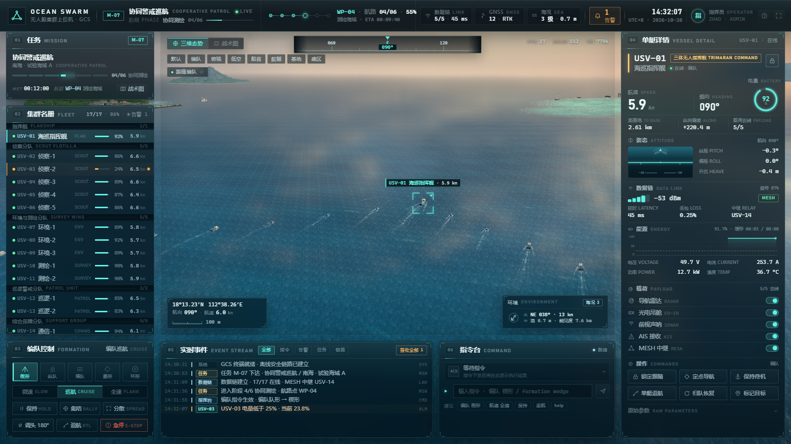
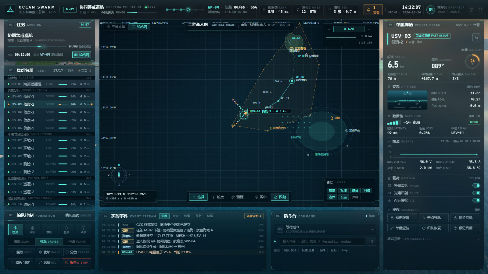
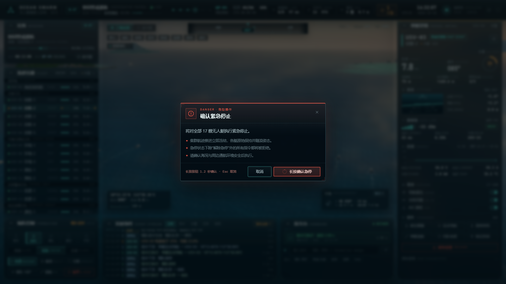
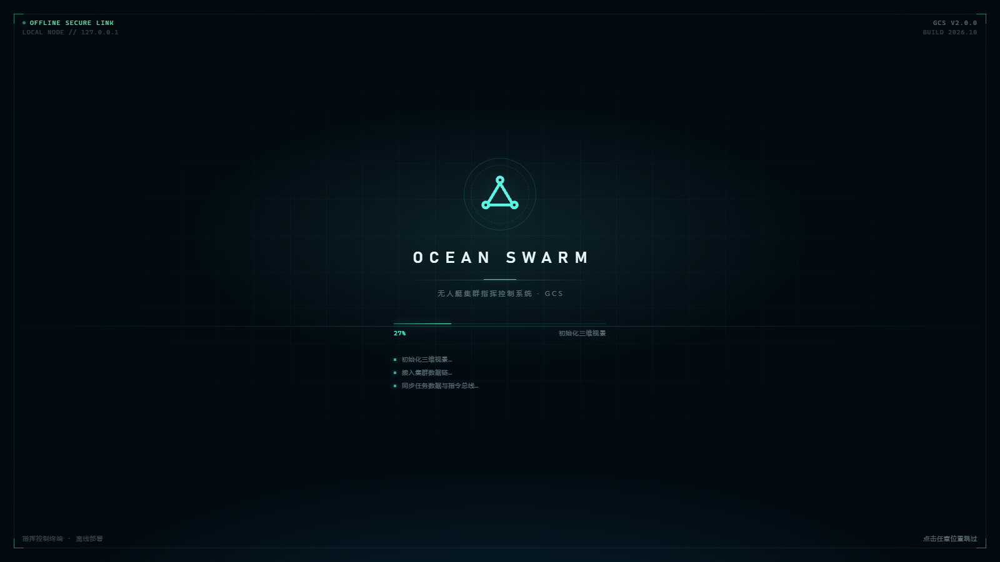
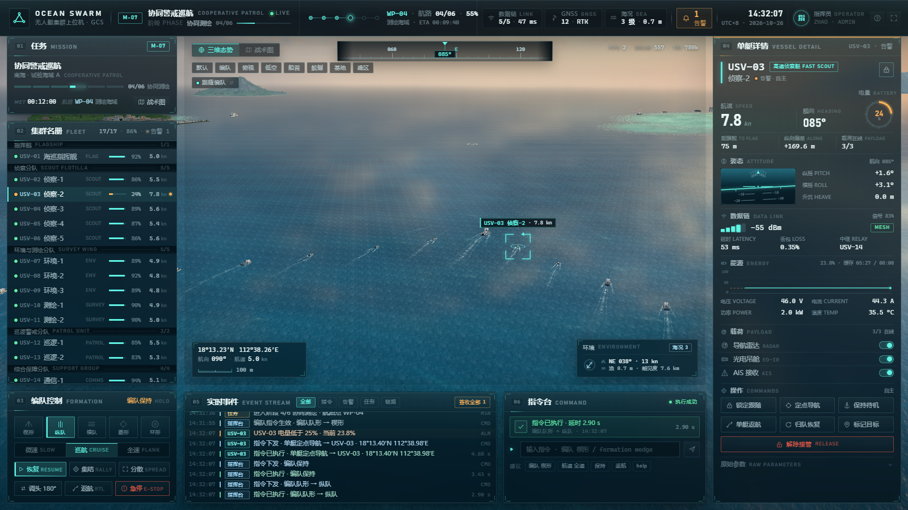
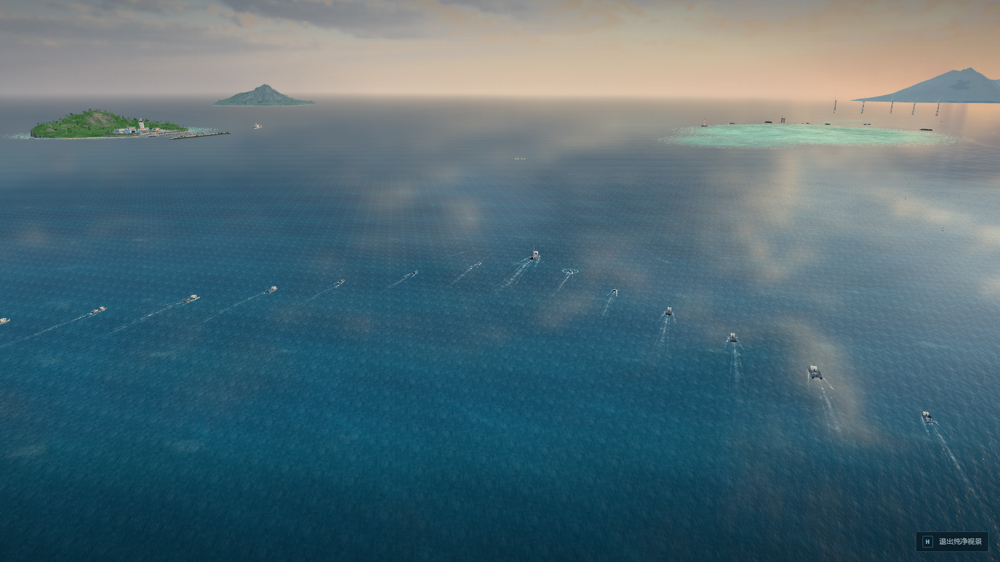

# OceanSwarm GCS — 无人艇集群地面指挥控制上位机

> **V2.0 · 无人艇集群上位机**。在继承的 OceanSwarm 三维海域场景之上，构建了一套可真正操作的
> **无人艇集群地面指挥控制台（GCS / 上位机）**：17 艘无人艇的实时遥测、编队与航速控制、单艇
> 定点派遣、集群返航 / 调头 / 急停、二维战术图、任务航路、告警引擎、事件流与指令台，
> 全部与 3D 场景中的真实运动闭环联动，并可完全离线运行。



**继承关系**：`OceanSwarm`（v1.2，Three.js 实时海域 + 17 艇程序化模型 + 编队动力学）作为
三维态势视景完整保留；本版本新增 `src/sim/`（遥测 / 数据链 / 告警 / 指令总线）、
`src/ui/`（上位机界面）与 `src/systems/swarm-control.js`（指令执行层），并扩展了
`src/systems/formation.js`（可变航速 / 转角、指令阵位、单艇自主导航）与 `src/main.js`
（相机导演、选中光效、拾取、控制台集成）。原始场景文档见
[docs/OceanSwarm-dev-doc.pdf](docs/OceanSwarm-dev-doc.pdf)。

- 上位机架构与接口契约：[docs/GCS-architecture.md](docs/GCS-architecture.md)
- 视觉设计系统：[docs/GCS-design-system.md](docs/GCS-design-system.md)

## 界面与能力

| 区域 | 内容 |
|---|---|
| **顶栏** | 集群徽标 · 任务 M-07「协同警戒巡航」· 阶段与航路进度 · 数据链 5/5（延时 / 丢包）· GNSS RTK · 海况 · 活动告警 · UTC+8 时钟 · 指挥员 |
| **左栏** | 任务卡（阶段刻度 / 任务时钟 MET / 当前航路点）· 17 艇集群名册（分组 / 状态 / 电量 / 航速，点击选中、双击锁定）· 编队控制（5 种队形 / 三档航速 / 保持 / 集结 / 分散 / 调头 / 返航 / 急停） |
| **中央视景** | 三维海域态势 + HUD（罗经带、视角预设、镜头模式、选中艇锁定框、经纬/航向/航速、动态比例尺、环境卡、渲染读数）；一键切换二维战术图 |
| **右栏** | 选中艇详情：呼号/型别/状态 · 英雄读数（航速 / 艏向 / 电量环）· 人工地平线姿态 · 数据链（RSSI/延时/丢包/中继）· 能源曲线与电压电流 · 载荷开关（雷达 / 光电 / 声呐 / AIS / MESH）· 单艇操作 · 原始参数 |
| **底栏** | 实时事件流（指令/告警/任务/链路过滤、未读计数、签收）· 指令台（最后回执、中英文命令、历史、补全、建议） |
| **覆盖层** | 开机自检动画 · 急停长按确认 · 键盘帮助 · Toast 通知 |

**指令闭环**：操作 → 指令总线（模拟数据链 220–650 ms 延时）→ 场景执行 → 回执 + 事件流。
例如切换「纵队」后，3D 场景中的 17 艘艇会在数秒内重新排成纵队；「返航」会让集群转向
2.4 km 外的试验基地并实时显示剩余距离；「急停」会冻结集群运动并在顶栏/事件流形成红色告警，
此时除「解除急停」外的指令都会被拒绝。任意单艇可被派往战术图上点选的位置，场景中会出现
目标光柱与航线，抵达后自动待机。

## 运行

```bash
npm install        # 已随仓库提供 node_modules 时可跳过
npm run dev        # http://127.0.0.1:5179
npm run build      # 生产构建（dist/）
npm run preview    # 预览构建产物，http://127.0.0.1:5180
```

本地素材（HDR 天空全景 4.4 MB、水面法线贴图 249 KB）随仓库分发，通过应用自身 base URL 加载，
运行时**不访问任何 CDN 或远程资源**。若素材缺失，场景会回退到程序化天空 / 程序化涟漪。

### URL 参数（调试 / 截图用）

| 参数 | 作用 |
|---|---|
| `?nointro=1` | 跳过开机自检动画 |
| `?seed=7` | 固定仿真随机种子（可复现截图与告警） |
| `?view=default\|fleet\|top\|low\|bow\|side\|base\|reef` | 初始相机预设 |

### 操作

- 鼠标：点击 3D 海面上的艇 / 名册行 / 战术图艇标选中；双击名册行或 3D 艇锁定跟随；
  拖拽旋转、滚轮缩放、右键平移视角。
- 键盘：`1`–`5` 编队队形 · `Shift+1/2/3` 微速/巡航/全速 · `Space` 编队保持/恢复 ·
  `U` 调头 · `F` 锁定选中艇 · `R` 跟随编队 · `M` 三维/战术图 · `H` 纯净视景 ·
  `Enter` 聚焦指令台 · `Esc` 关闭弹层/取消地图工具 · `?` 帮助。
- 指令台示例：`编队 楔形`、`formation column`、`航速 全速`、`保持`、`返航`、`急停`、
  `select scout-2`、`goto 900 -200`、`help`。

## 截图

| | |
|---|---|
|  |  |
|  |  |
|  |  |

## 架构

```
界面层 src/ui/            DOM + Canvas 2D 上位机（各面板 lazy mount，单面板故障隔离）
  ├─ shell.js             区域骨架（顶栏/左栏/中央视区/右栏/底栏/覆盖层）
  ├─ context.js           UI 状态、actions、事件总线、dialog 服务
  ├─ panels/*.js          topbar / left / hud / map / detail / dock / overlays
  └─ charts.js            手写 Canvas 仪表与图表（无图表库依赖）
仿真层 src/sim/           10 Hz 遥测建模、数据链、告警规则、事件环形缓冲、指令总线
场景层 src/main.js        既有 Three.js 场景装配 + GCS 集成
  ├─ systems/swarm-control.js   编队阵位补间 / 航速 / 保持 / 调头 / 返航 / 急停 / 单艇导航
  ├─ systems/camera-director.js 跟随编队 / 锁定目标 / 自由视角
  ├─ systems/formation.js       既有编队动力学（扩展可变航速转角、指令阵位、自主艇）
  └─ objects/effects/selection.js 选中光环、航点光柱、派遣航线
```

数据流：`Fleet → SwarmControl → sceneProvider → Sim(10Hz) → snapshot → 各面板`；
操作走 `actions → Sim.dispatch → 延时 → SwarmControl.command → 场景运动 → 回执事件`。
界面不直接读写 Three.js 对象，所有数值来自快照，3D 投影与实时光标由 `ctx.scene3d` 提供。

## 质量验证

- **整机回归**：`npm run qa:gcs`（Headless Chromium / SwiftShader）最近一次 **25/25 断言通过**、
  **零 console error / pageerror**、**零外部网络请求**；覆盖：面板挂载、17 艇遥测有限值、
  名册点击联动、战术图切换、航点派遣与回执、编队指令回执、急停弹层、帮助弹层、
  指令台执行、纯净视景、开机门闩、3D 拾取、键盘快捷键、急停长按确认、急停下指令拒绝与恢复。
  截图与报告：`artifacts/gcs/run-final/`（gitignore）。
- **仿真引擎**：`node artifacts/sim/selftest.mjs` → **29/29 PASS**（全字段 schema、15 类指令与
  9 种拒绝路径、告警触发/升级/恢复、暂停态回执、确定性复现）；`node artifacts/sim/browser-check.mjs`
  → **15/15 PASS**（真实页面集成）。
- **构建**：`npm run build` 通过，产物仍完全离线（无 CDN / 无远程字体）。
- **视觉审查**：design owner 以 2× 截图逐区审查并通过（面板玻璃、标题行、角标、滚动条、密度、
  对齐、亮天空可读性）；最终视觉基线见 `docs/figures/gcs-*.png`。

## 目录结构

```
src/
  main.js                 场景装配 + GCS 集成（相机导演、拾取、仿真与 UI 装配）
  config.js               既有场景配置（调色板 / 世界布局 / 编队名册）
  gcs/meta.js             上位机领域常量（任务 / 呼号 / 分组 / 队形 / 载荷 / 经纬度原点）
  gcs/scene-bridge.js     三维场景与世界真值适配（scene3d / sceneProvider）
  sim/                    仿真引擎（model / commands / alarms / events / domain / format）
  ui/                     上位机界面（见上）
  core/ objects/ systems/ 继承的场景模块（海洋 / 天空 / 船体 / 世界 / 编队）
public/                   本地 HDR 与水面法线贴图
docs/                     本文档、GCS 架构与设计文档、继承的场景开发文档
artifacts/gcs/            截图与回归脚本（gitignore）
```

## 素材与许可

继承自 OceanSwarm：天空全景 **Poly Haven “Kloppenheim 06（Pure Sky）”**（Greg Zaal /
Jarod Guest，**CC0 1.0**）；水面法线贴图来自 three.js 官方 Water 示例（**MIT**）。
完整署名与替换说明见 [CREDITS.md](CREDITS.md)。本版本仅新增纯代码与内联 SVG 图标，
不含任何新的第三方素材；界面字体使用系统字体栈，离线可用。

## 说明

- 本仓库为在继承项目之上的**独立工程**，原始 OceanSwarm 仓库未被修改。
- 上位机中的任务、海况、链路、告警与艇号均为仿真数据（由 `src/sim/` 按场景真值实时生成），
  用于演示指挥控制流程与交互设计，不构成真实航行控制软件。
