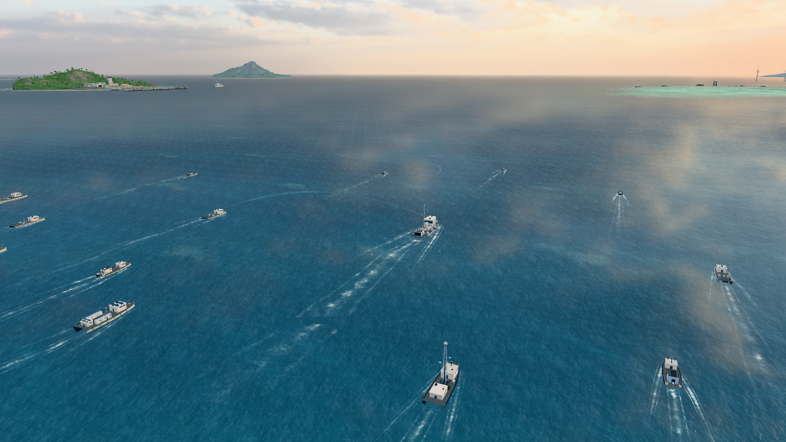
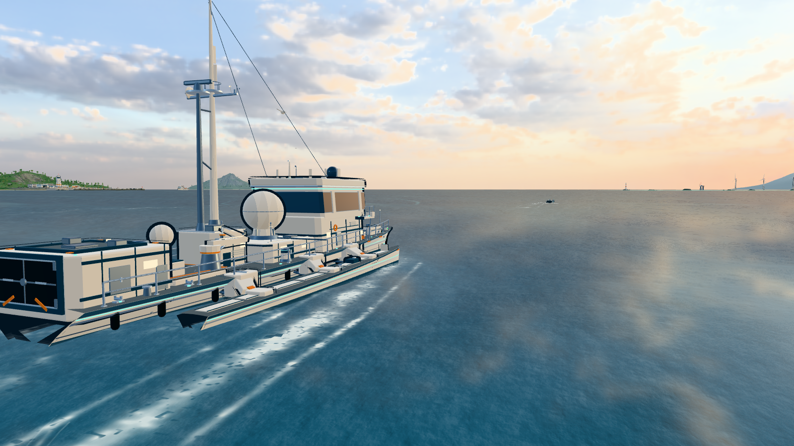
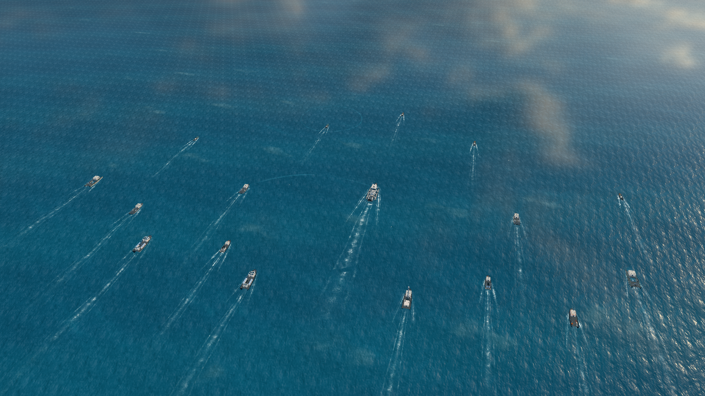
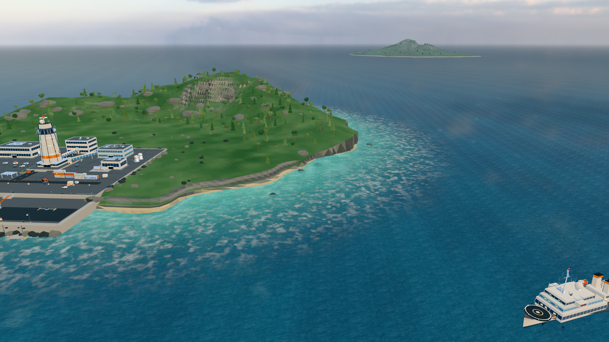
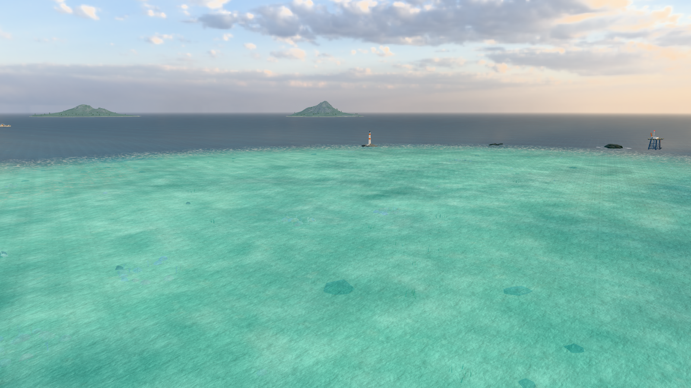
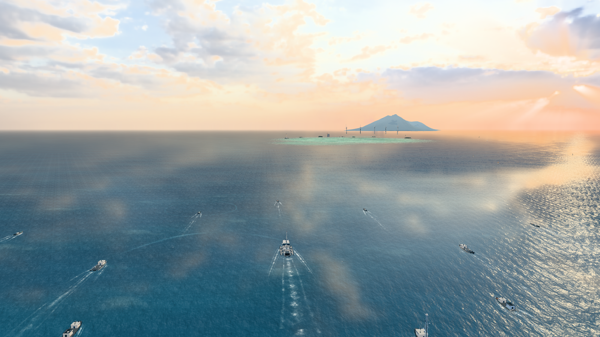
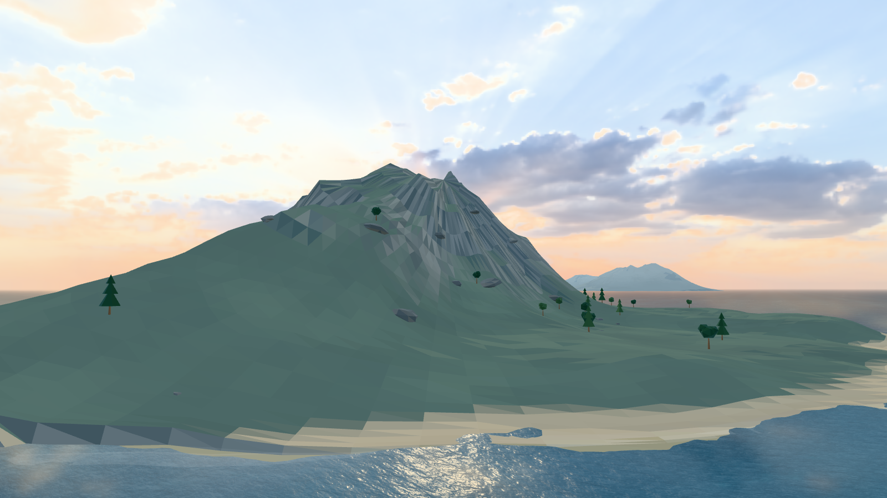

# OceanSwarm — 未来智能无人艇集群协同巡航海域

一片数公里尺度的开放海域，17 艘不同类型的智能无人艇（含一艘 30 m 三体无人指挥旗舰）以协同编队巡航。
船体、海岛、珊瑚礁、波浪、尾迹与光效均由 Three.js 程序化几何与着色器实时生成；外部素材只有两张随仓库分发的
本地贴图——一张 2K HDR 天空全景（Poly Haven “Kloppenheim 06（Pure Sky）”，CC0）与一张水面法线贴图
（three.js 官方示例纹理，MIT）——全部同源加载、可完全离线运行。

**v1.1 天空 HDR 升级**：用真实拍摄的全景 HDR 取代此前的程序化渐变穹顶、画布云精灵与太阳光晕——
随视角环绕可以看到真实方向的逆光积云、散布云与深蓝天顶，海面菲涅尔反射、远处地平线雾以及金属/玻璃的
环境反射都采样同一张全景，主光方向与全景中烘焙的低角度太阳对齐。

**v1.2 水面细节升级**：海面改为“程序化波形 + 照片法线贴图微细节”——本地 1024² 水面法线贴图以三个拉伸、
缓慢漂移的坐标层采样（近景毛细波 / 中景细浪 / 远景风斑），同时驱动反射扰动与太阳碎金；低角度太阳下涟漪
面片还会产生微明暗变化，配合进一步压暗的深水基底色，呈现“暗水体 + 环境反射”的深蓝质感。



- 项目仓库：<https://github.com/ZHT1235456/OceanSwarm>
- 开发文档（中文 LaTeX）：[docs/OceanSwarm-dev-doc.pdf](docs/OceanSwarm-dev-doc.pdf) · [LaTeX 源码](docs/OceanSwarm-dev-doc.tex)

## 效果预览

| | |
|---|---|
|  |  |
|  |  |
|  |  |

## 运行

```bash
npm install
npm run dev        # http://127.0.0.1:5179
npm run build      # production build (dist/)
```

本地素材（HDR 天空全景 `public/hdr/kloppenheim_06_puresky_2k.hdr`，约 4.4 MB；水面法线贴图
`public/textures/waternormals.jpg`，约 249 KB）**均已包含在仓库中**，无需任何额外下载：Vite 直接从
应用自身的 base URL 提供这些文件，运行时不访问 CDN 或任何远程资源。若 HDR 缺失，场景会回退到程序化天空；
若水面法线贴图缺失，海面会回退到程序化涟漪，两者都会在控制台给出提示。

生产构建使用 `build.target = 'es2022'`（见 `vite.config.js`）：`src/main.js` 通过顶层 `await`
在装配场景前并行预加载 HDR 全景与水面法线贴图，es2022 对应 Chrome/Edge ≥ 94、Firefox ≥ 93、Safari ≥ 15.4。
`npm run build` 的 `dist/` 约 5.55 MB（JavaScript 867 KB + gzip 247 KB + HDR 4.43 MB + 水面法线 249 KB）。

## 交互

纯第三人称自由视角，无任何 UI / 文本 / 悬浮面板：

- 左键拖拽：旋转视角
- 滚轮：平滑缩放（16 m – 4200 m）
- 右键拖拽：平移观察
- 视角带阻尼；相机随编队缓慢巡航，可自由靠近水面观察船体、或拉高俯瞰整个集群

## 场景内容

- **海洋**：自定义 ShaderMaterial 海面；CPU/GPU 共享 7 组方向波，船体随浪起伏 / 纵摇 / 横摇；
  本地 1024² 照片法线贴图提供三层拉伸漂移的微细节（近景毛细波 / 中景细浪 / 远景风斑），用于扰动反射、
  增强太阳碎金，并让低角度太阳下的涟漪面片产生微明暗；深水基底色压暗、以环境反射塑形，呈现“暗水体 +
  环境反射”的深蓝质感；菲涅尔天空反射、稀疏白浪、云影、深浅水色与大气雾；海面网格跟随相机、半径 26 km，
  菲涅尔反射与远处地平线雾都采样同一张 HDR 全景（逐视线方向），地平线无缝衔接。
- **天空与光照（HDR 大气）**：天空穹顶以等距圆柱投影采样本地 2K HDR 全景 “Kloppenheim 06（Pure Sky）”
  （CC0，方位角 40.7°、仰角 4.7° 的金色低角度太阳）；真实全景使环绕视角依次呈现逆光积云、散布积云与深蓝天顶。
  同一全景还用于海面反射 / 地平线雾，并经 `PMREMGenerator` 预滤波作为金属与玻璃的环境反射；
  主光、补光与半球光按 HDR 中烘焙的太阳方向重新配比。加载失败时回退到程序化天空。
- **无人艇集群**：1 艘 30 m 三体旗舰（双雷达罩、通信桅杆、旋转雷达、光电球、UUV 机库、折臂吊、
  舷侧灯带 / 护舷 / 护栏 / 航行灯），以及 16 艘 10–20 m 的高速侦察、环境监测、海洋测绘（双体）、
  多用途巡逻、通信中继、能源保障、无人救援艇；程序化 Builder 合批几何 + 卡通轮廓线。
- **编队与航行动画**：旗舰沿数公里尺度的大圆弧缓慢转向，各艇保持编队阵位并带自然摆动；
  侦察艇周期性向外展开；软弹簧跟随 + 差异化的航向修正。
- **尾迹 / 技术光效**：17 套独立的历史轨迹尾迹带、船首 V 形破浪、船侧泡沫线、尾流泡沫；
  克制的青蓝色通信弧线、扫描波纹与测绘扇形探测光束；海鸥群。
- **环境**：左侧中远景岩石海岛上的未来海洋无人系统试验基地（指挥塔 / 模块建筑 / 栈桥码头 / 无人艇泊位）、
  120 m 海洋保障母船、右侧浅海珊瑚礁潟湖（海底沙脊 / 珊瑚 / 海草 / 鱼群）、航标浮标阵列、灯塔、
  海上观测平台、远方风电场、三座远近海岛；天空、云与低角度太阳由 HDR 全景提供（见上）。

## 代码结构

```
src/
  main.js                 场景装配、渲染循环、相机预设、灯光、QA 调试钩子
  config.js               调色板 / 世界布局 / 编队名册 / 相机与光照参数
  core/
    geo.js                程序化几何工具、Builder 合批、船体 hullParts 生成器
    hdri.js               HDR 全景加载（HDRLoader + PMREM 环境光照贴图）
    materials.js          卡通材质库 + HDR 环境反射（回退：程序化天空）
    waves.js              CPU/GPU 共享波场
    water-normal.js       水面法线贴图加载（TextureLoader，RepeatWrapping + mipmap）
    ocean.js              海面网格与海洋着色器（HDR 反射 + 三层法线细节 + 逐方向地平线雾）
    sky.js                HDR 天空穹顶、程序化回退与共享天空采样 GLSL
  systems/formation.js    编队航路、阵位保持、随浪姿态
  objects/
    ships/                旗舰与 7 级无人艇程序化模型
    world/                海岛 / 珊瑚礁 / 海上基地 / 母船 / 航标与设施
    effects/              尾迹 / 通信与扫描光效 / 海鸥
```

## 素材与许可

天空全景：Poly Haven **“Kloppenheim 06（Pure Sky）”** — Greg Zaal（原始全景）、Jarod Guest（天空编辑），
**CC0 1.0 Universal** 许可，<https://polyhaven.com/a/kloppenheim_06_puresky>；仓库内使用官方 2K HDR
（`public/hdr/kloppenheim_06_puresky_2k.hdr`，4 434 394 字节，MD5 `590a829b3cf71216451655e601d542c6`，
2048 × 1024 等距圆柱投影）。

水面法线：three.js 官方 “Water” 示例纹理 <https://threejs.org/examples/textures/waternormals.jpg>，
**MIT** 许可（随 three.js 仓库分发）；仓库内文件 `public/textures/waternormals.jpg`（1024 × 1024，
248 813 字节，SHA256 `add9912b158a4fe9c12421745babe68c44c8af75631ac4837236cb2a03bc373f`），
由 `src/core/water-normal.js` 加载，在海洋着色器中三层复用。

除上述两张本地贴图外，场景其余内容均为程序化生成，不使用其他外部贴图、模型或 HDR 资源。
完整署名、许可说明、两项素材的渲染用途与替换方法见 [CREDITS.md](CREDITS.md)。
